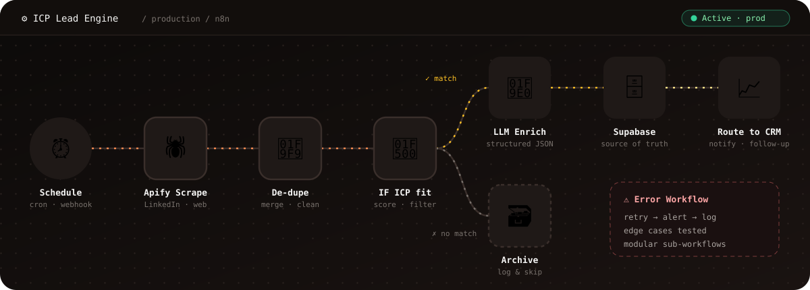

assets/
  brand_footer.svg
  divider.svg
  hero.svg
  impact.svg
  research_agent.svg
  services.svg
  workflow.svg
README.md

<p align="left">
  
  <a href="https://www.linkedin.com/in/vansh-aggarwal-a3572b1bb"></a>
  <a href="mailto:vanshkr2510@gmail.com"></a>
  
  
  
</p>

<a href="https://git.io/typing-svg">
  
</a>

<br/><br/>






### `01` — about me

Hey, I'm **Vansh**, an **AI Automation Engineer** from New Delhi. 👋

I build **production n8n workflows, LLM-powered agents and API-connected business systems** at **REN AI Technologies (NimitAI)**, an AI sales-intelligence startup in Gurugram. My work sits behind the sales team: systems that **find the right prospects, research them, qualify them and get them to the right rep**, automatically and reliably.

In under a year I've shipped a **sales CRM that a 15+ member team runs on every day**, an **ICP lead engine that delivers 2,000+ qualified leads a week**, and research automations that **save the team 50+ hours of manual work every week**. I'm trained in **Python** and **Retrieval-Augmented Generation (RAG)**, I've built an **AI voice-calling agent** for real estate, and my next focus is **tool-connected agents and MCP-based automation**.

**What I bring to a team**

- 🔌 **I connect everything.** AI models, scrapers, databases and business tools wired together through REST APIs, webhooks, OAuth and JSON.
- 🧱 **I build for production, not demos.** Modular workflows, end-to-end tests, error handling and edge cases covered.
- 🧠 **I make LLMs reliable.** Prompt engineering and **structured JSON outputs** that downstream systems can trust.
- 📈 **I understand sales.** CRM systems, ICP and prospect research, lead generation, enrichment and sales-process automation.
- 🤝 **I own delivery end to end.** From scoping requirements to deployment and ongoing maintenance, for internal teams and clients.

```yaml
# vansh.workflow.yml
engineer:
  name: Vansh
  role: AI Automation Engineer
  location: New Delhi, India
  at: REN AI Technologies (NimitAI) · Gurugram
  since: 2026-02
  education: BCA · Indira Gandhi National Open University (IGNOU) · 2025

builds:
  - production n8n workflows (modular, tested, error-handled)
  - AI agents · RAG · voice AI · human-in-the-loop approval
  - sales CRMs, lead-gen & enrichment engines
  - integrations: REST · webhooks · HTTP · OAuth · JSON

models:   [Gemini, OpenAI, Claude, Azure OpenAI]
data:     [Apify, Serper, Supabase (+ vectors), Google Sheets, Excel]
cloud:    [Google Cloud (self-hosted n8n)]
code:     [Python, JavaScript (n8n Code nodes), SQL, HTML/CSS]

shipped:
  qualified_leads_per_week: 2000+
  research_hours_saved_per_week: 50+
  sales_reps_on_my_crm_daily: 15+
  research_dossier_time: ~3 min

next: tool-connected agents & MCP-based automation
```

### 🛠️ how I build

| | Principle | In practice |
| :---: | :--- | :--- |
| 🧩 | **Modular over monolithic** | Big workflows split into reusable sub-workflows, so failures are easy to isolate |
| 🧪 | **Tested end to end** | Every workflow is run against happy paths, edge cases and bad data before it ships |
| 📦 | **Structured outputs** | LLM responses shaped into strict JSON for the next system in the chain |
| 🛡️ | **Built to fail safely** | Error branches, retries, alerts and activity logs on everything in production |
| 👤 | **Humans where it matters** | Approval steps before an agent says anything public |


### `02` — featured: ConvertWise Research Agent

**Give it a LinkedIn URL and a company name. About 3 minutes later, a rep has a complete behavioral dossier on the person they're about to meet.**

I built this prospect-intelligence agent for **ConvertWise** at REN AI Technologies (NimitAI). It's aimed at **Indian enterprise B2B deals (₹50L–₹5Cr)**, where walking into a meeting under-prepared costs real money. The whole system is **4 n8n workflows that trigger each other**, **12 chained Gemini prompts**, and a Supabase backend with **vector embeddings for RAG**, running at **about ₹35–43 per prospect**.



| Workflow | What it does | Output |
| :--- | :--- | :--- |
| 🕷️ **WF1 · Scraper** | Apify pulls the prospect's LinkedIn **profile, posts and comments** | Raw data stored in Supabase |
| 🧠 **WF2 · Prospect Analyzer** | **5 AI calls**: profile → posts → comments → signal clustering → DISC behavioral synthesis | Behavioral profile, decision style, communication guide |
| 🏢 **WF3 · Company Intel** | **3 Google searches (Serper) + 4 AI calls**: company signals → financials → market position → SWOT | SWOT with ConvertWise alignment for each quadrant |
| 📄 **WF4 · Dossier Generator** | **RAG lookup + 3 AI calls**: meeting strategy → confidence scoring → final assembly | The complete prospect dossier as JSON |

**What lands in the rep's hands**

- 🧬 **DISC behavioral profile**: how the prospect decides, communicates and what they care about
- 📐 **5 decision dimensions** (speed, data needs, risk tolerance, input preference, decision mode) and **5 communication dimensions** (formality, channel, pace, engagement style, depth)
- 🏢 **Company SWOT**, mapped to where ConvertWise fits
- 🎤 **Meeting strategy**: a word-for-word opening script, talking points and an **objection playbook with response scripts**
- 📊 **Confidence scores (0.0–1.0)** for every section, plus **risk flags** for data gaps, contradictions and anything that needs manual review

**Engineering details I'm proud of**

- 🔗 **Self-chaining workflows.** Each workflow calls the next through its webhook, so one trigger runs the whole pipeline end to end.
- 📦 **Guaranteed-valid JSON.** Every Gemini node uses `responseMimeType: application/json`, so the downstream steps never choke on bad output.
- 🗄️ **Full traceability.** Five Supabase tables (`meeting_sessions`, `raw_scrapes`, `prospect_analyses`, `company_analyses`, `prospect_dossiers`) record every step of every run.
- ☁️ **Self-hosted.** n8n runs on **Google Cloud**, with API keys kept in n8n's own environment settings.

```
LinkedIn URL + company ─► WF1 Scrape ─► WF2 Analyze ─► WF3 Company Intel ─► WF4 Dossier ─► JSON
                          (Apify)       (5× Gemini)     (3× Serper, 4× Gemini) (RAG, 3× Gemini)
                             └──────────────── Supabase · 5 tables · vector embeddings ───────────────┘
```

<p>
  
  
  
  
  
  
  
  
</p>

<!-- Once the repo is public, uncomment the line below and put in the real URL -->
<!-- <a href="https://github.com/Vanshkr2510/REPO-NAME"></a> -->


### `03` — the lead engine I built

This is the shape of the **ICP lead engine** I built at NimitAI. It scrapes, cleans, qualifies against the ICP, enriches with an LLM, stores in Supabase and routes each lead into the CRM. Leads that don't fit are logged and skipped, and an error workflow catches anything that breaks.




### `04` — experience

> **🟠 AI Automation Engineer** · REN AI Technologies (NimitAI) · Gurugram, India  
> `Feb 2026 → present` · AI sales-intelligence startup

| What I built | Impact |
| :--- | :--- |
| 🗂️ **End-to-end sales CRM & tracking system** for leads, deal stages, activities and follow-ups | Adopted by a **15+ member sales team** as its daily single source of truth |
| 🎯 **ICP lead-generation & enrichment engine** that collects, de-duplicates, qualifies and routes prospects | **2,000+ qualified leads every week** |
| 🔎 **Prospect research automation** | **50+ hours/week** of manual research removed |
| 🧠 **ConvertWise Research Agent**: 4 chained n8n workflows (Apify → Gemini → Serper → RAG) that turn a LinkedIn URL into a full DISC + SWOT dossier with an objection playbook | **About 3 minutes and ₹35–43 per prospect** |
| 🔁 **CRM workflow automations** for lead routing, notifications and follow-up triggers across Apify, Supabase, Google Sheets and AI models | No lead goes untouched |
| 🔌 **System integrations** connecting AI models, scrapers, databases and business tools via REST APIs, webhooks, OAuth and JSON | One connected stack instead of manual hand-offs |
| 🧩 **Monolith → modular refactor** of large workflows, with end-to-end testing and edge-case handling | Easier debugging, better maintainability and production reliability |
| 🧪 **LLM output engineering**: errors handled and responses refined into structured JSON | Clean, dependable data for downstream systems |
| ✍️ **AI content workflows** for social-media content generation and publishing | Content produced and published on autopilot |
| 🤝 **Custom client automations**, from requirement scoping through implementation, testing, deployment and maintenance | Delivered for multiple clients |


### `05` — projects

<details open>
<summary><b>🎙️ Real Estate AI Voice Calling Agent</b> &nbsp;·&nbsp; <code>Voice AI</code> <code>LLM</code> <code>Lead Qualification</code></summary>
<br/>

An AI-powered voice agent that runs **outbound conversations with property prospects**. It **qualifies leads during the call** and supports ongoing engagement, so nobody has to dial manually.

```
lead list → AI voice call → in-call qualification → engagement & follow-up → CRM update
```
</details>

<details>
<summary><b>👾 Reddit AI Agent</b> &nbsp;·&nbsp; <code>n8n</code> <code>RAG</code> <code>Human-in-the-loop</code></summary>
<br/>

Monitors subreddits and finds threads that matter. It **retrieves knowledge-base context** and drafts contextual replies. A human **approves every reply** before it goes out, and all activity is logged.

```
subreddit watch → relevance filter → KB retrieval → LLM draft → manual approval → activity log
```
</details>

<details>
<summary><b>✍️ AI Social Content Workflows</b> &nbsp;·&nbsp; <code>n8n</code> <code>LLM</code> <code>Publishing</code></summary>
<br/>

Workflows that use AI to **generate social-media content and publish it**, taking a content idea all the way to a scheduled post.

```
topic / brief → LLM content generation → review → publish
```
</details>

<details>
<summary><b>🔄 Google Sheets → GitHub Issues Sync</b> &nbsp;·&nbsp; <code>n8n</code> <code>GitHub API</code> <code>Sheets</code></summary>
<br/>

Converts structured spreadsheet entries into **standardised GitHub issues** with labels and fields. This removes manual copy-paste between the business and dev teams.

```
sheet row → validate & map → GitHub issue (labels + fields)
```
</details>

<details>
<summary><b>📜 Certificate & Document Generator</b> &nbsp;·&nbsp; <code>Automation</code> <code>CSV/Excel</code> <code>PDF</code></summary>
<br/>

Turns CSV/Excel data into **personalised PDF certificates** and delivers each one to its recipient automatically.

```
CSV / Excel → template merge → PDF render → auto delivery
```
</details>

<details>
<summary><b>🔗 MCP-Ready Automation Foundation</b> &nbsp;·&nbsp; <code>APIs</code> <code>Webhooks</code> <code>JSON</code> <code>MCP</code></summary>
<br/>

Hands-on experience **connecting agents and workflows to external tools and data** through APIs, webhooks and structured JSON. That is the same foundation MCP-connected agents are built on, and it's where I'm heading next: building and testing **MCP-connected workflows**.

```
agent ⇄ tools (APIs · webhooks) ⇄ data (Supabase · Sheets) → structured JSON contracts
```
</details>


### `06` — skills

| Area | Skills |
| :--- | :--- |
| 🤖 **AI & Agents** | LLM integrations · AI agents · prompt engineering · prompt chaining · RAG · vector embeddings · voice AI · structured JSON outputs |
| 🔁 **Automation** | n8n · workflow architecture · workflow testing & debugging · business-process automation |
| 🔌 **Integrations** | REST APIs · webhooks · HTTP requests · OAuth · JSON · Postman |
| 🧠 **AI Platforms** | OpenAI · Gemini · Claude · Azure OpenAI |
| 🗄️ **Data & Tools** | Apify · Serper · Supabase · Google Sheets · Excel · Git · GitHub · VS Code |
| ☁️ **Hosting** | Self-hosted n8n on Google Cloud |
| 💻 **Programming** | Python · JavaScript (n8n Code nodes) · SQL · HTML/CSS |
| 📈 **Domain** | CRM systems · lead generation & enrichment · ICP & prospect research · sales-process automation |

<p>
  
  
  
  
  
  
  
  
  
  
  
  
  
  
</p>

<a href="https://skillicons.dev">
  
</a>


### `07` — education

> **🎓 Bachelor of Computer Applications (BCA)**  
> Indira Gandhi National Open University (IGNOU) · `Completed Aug 2025`

Alongside my degree I trained in **Python** and **Retrieval-Augmented Generation (RAG)**. Since then I've been learning the way I like best: by shipping production automations.


### `08` — on my radar

Open-source agentic tools I've forked to study and build on. Both are close to what I do every day: AI-driven sales outreach and automated social content.

| Repo | What it is | Why I'm digging into it |
| :--- | :--- | :--- |
| [🍴 **harvey_linkedin**](https://github.com/Vanshkr2510/harvey_linkedin) | Fork of an autonomous AI sales agent running on Claude Code / Codex. It finds prospects, writes cold emails, runs campaigns, handles replies and books meetings | Agentic outreach is the next step after the lead engines I build |
| [🍴 **postiz-app**](https://github.com/Vanshkr2510/postiz-app) | Fork of Postiz, an open-source agentic social-media scheduling tool | Connects to the AI content-generation and publishing workflows I ship |


### `09` — activity

<p align="center">
  
</p>


### `10` — let's work together

Got a manual process that eats your team's week? A lead source nobody has time to research? An AI agent idea that needs wiring into real tools? **That's exactly what I like building.**

<p>
  <a href="mailto:vanshkr2510@gmail.com"></a>
  <a href="https://www.linkedin.com/in/vansh-aggarwal-a3572b1bb"></a>
  <a href="tel:+919821135667"></a>
  <a href="https://github.com/Vanshkr2510"></a>
</p>

📍 New Delhi, India &nbsp;·&nbsp; 🟢 Open to AI automation roles & freelance projects


